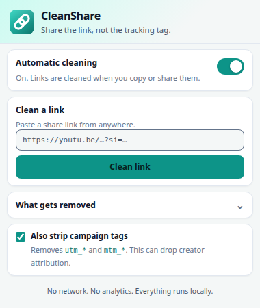

# CleanShare

A small Chrome extension that removes the tracking tail social platforms add
when you press **Share** or **Copy link**.



The link still opens the same post or video. The account-bound share token,
the app/device code, and the campaign tags are gone before the link reaches
your clipboard or the native share sheet.

## The problem

Share buttons do not hand you the URL you see in the address bar. They build a
new one with attribution parameters:

```diff
- https://youtu.be/dQw4w9WgXcQ?si=hK3nR9pQ2mF7xW
+ https://youtu.be/dQw4w9WgXcQ

- https://x.com/user/status/123?a=Kq3vX9mPzR2tLw8nYb4c&s=19
+ https://x.com/user/status/123

- https://www.facebook.com/share/p/ABC/?mibextid=wwXIfr&rdid=xyz
+ https://www.facebook.com/share/p/ABC/

- https://www.instagram.com/reel/ABC/?igsh=tracking
+ https://www.instagram.com/reel/ABC/
```

The YouTube token is the one that worries people most: `si` (and its 2026
rename, `is`) is generated per share and has been reported to connect a link
to the channel that shared it. X's `a`/`t` tokens do the same kind of job for
X, while `s` records the app or device family (19 Android, 20 web, 46 iPhone).

None of these parameters are needed to load the content.

## What gets removed

| Where | Parameters | What they are |
| --- | --- | --- |
| YouTube | `si`, `is`, `pp`, `feature` | Share id / account-bound token, playback-surface context, source attribution |
| X / Twitter | `a`, `s`, `t`, `cn`, `ref_src`, `ref_url`, `refsrc`, `src`, `twclid` | Share token, app/device code, session token, referral and click ids |
| Facebook | `fbclid`, `mibextid`, `rdid`, `shbid`, `shbv`, `sfnsn`, `__cft__[…]`, `__tn__`, `hc_ref`, `fref`, `ref`, `refid`, `comment_tracking`, `dti`, `tracking`, `referral_code`, `referral_story_type` | Click ids and app-share / surface attribution |
| Instagram | `igsh`, `igshid`, `igsi` | Old and new account-bound share ids |
| Any site | `fbclid`, `twclid` | Meta and X click identifiers |
| Any site (optional) | `utm_*`, `mtm_*` | Campaign tags; on by default, switchable in the popup |

### Deliberately kept

Cutting everything after `?` is the usual mistake. These parameters still work:

- YouTube: `v` (video id), `t` and `start` (start timestamp, both `t=12312`
  and `t=1m30s` forms), `list` and `index` (playlist context), `ab_channel`
  (the channel's name, not the sharer's identity).
- X: search parameters such as `q`, `f`, `pf`, `lf`.
- Instagram: `img_index` (which carousel slide).
- Facebook: `id`, `fbid`, `v`, `set` and the rest of the URL's real content.

The cleaner removes named parameters only. It never truncates the query string
and never changes the host or path. For example, a timestamped share link loses
only its tracking tail:

```diff
- https://youtu.be/dQw4w9WgXcQ?si=hK3nR9pQ&t=12312
+ https://youtu.be/dQw4w9WgXcQ?t=12312
```

## Research notes (November 2026)

Platforms do not document these parameters, and they rename them when the old
names get blocked. The rules here were compiled from observed share links,
open-source rule sets, and reporting from 2026. Two recent changes matter:

- **YouTube** replaced `si` with `is` in early 2026. Both spellings are in the
  removal list, so links keep getting cleaned whichever one YouTube hands out.
- **X** added `a` in late October 2026. It appears alongside the older `s`
  (app code) and `t` (share token).
- **Instagram** started appending `igsi` in August 2026, alongside `igsh` and
  the older `igshid`.
- **Meta** app shares use `mibextid` and `rdid`; `fbclid` is the per-click
  identifier attached to outbound links.

If a platform renames a parameter again, add the new name to `HOST_RULES` in
[`src/cleaner.js`](src/cleaner.js). The tests are intentionally small and easy
to extend.

### Sources

- [Unsnitch](https://github.com/xBrokkr/unsnitch) — X `a`/`s`/`t`, app codes,
  and the account-bound token explanation.
- [Numerama, 28 Oct 2026](https://www.numerama.com/tech/2363157-vous-devriez-effacer-la-fin-de-vos-liens-x-avant-de-les-partager.html)
  — reporting on X's new `a` parameter.
- [fixupxer v2.6.2](https://newreleases.io/project/github/NeatCode-Labs/fixupxer/release/v2.6.2)
  — YouTube's `si` → `is` rename (August 2026).
- [bbaovanc.com commit](https://git.bbaovanc.com/bbaovanc.com/bbaovanc.com/commit/dfe07567f8e307f604e25b3d51734e3d246371c4)
  — the privacy concern behind YouTube `si`/`is`.
- [Link Cleaner: the YouTube si parameter](https://linkcleaner.online/blog/youtube-si-parameter)
  — YouTube `pp`, `feature`, and why `t`/`list` must stay.
- [Link Cleaner: URL tracking parameter glossary](https://linkcleaner.online/blog/url-tracking-parameters-glossary)
  — share identifiers, click ids, and functional parameters.
- [CleanLinks: Facebook link cleaner](https://cleanlinks.app/en/facebook-link-cleaner)
  — `mibextid`, `rdid`, `shbid`, `shbv`.
- [fixupxer v2.6.3](https://newreleases.io/project/github/NeatCode-Labs/fixupxer/release/v2.6.3)
  — Instagram's `igsi`.
- [ClearURLs Rules](https://github.com/ClearURLs/Rules) — the continuously
  updated open-source parameter lists used as a cross-check.

## Install

1. Open `chrome://extensions`.
2. Turn on **Developer mode**.
3. Click **Load unpacked** and choose the folder that contains `manifest.json`.
4. Pin CleanShare to the toolbar.

### Browser support

CleanShare needs **Chrome 95 or newer**. It uses Manifest V3 and
[`chrome.scripting`](https://developer.chrome.com/docs/extensions/reference/api/scripting).

- **Chrome 102+:** the service worker registers the page-world cleaner with
  `world: "MAIN"` and `runAt: "document_start"`, so wrapping starts before the
  page's own scripts.
- **Chrome 95–101:** `registerContentScripts` does not support the `world`
  option, so the bridge asks the service worker to inject after the page loads.
  Copy and share cleaning still works. A site that caches clipboard APIs during
  startup could bypass it on these versions.

The manifest-only alternative (`"world": "MAIN"` in `content_scripts`,
[Chrome 111+](https://developer.chrome.com/docs/extensions/reference/manifest/content-scripts))
would exclude older browsers, so the extension does not use it. Check your
version at `chrome://version`.

Tested on Chrome 136.

Then open a post on X, YouTube, Facebook or Instagram, use **Share → Copy
link**, and paste. The tags should be gone.

## How it works

The extension has a small service worker and makes no network requests.

- `src/bridge.js` runs in Chrome's isolated world on the four supported sites,
  reads the toggle settings from `chrome.storage.sync`, and publishes them to
  the page as a `data-cleanshare` attribute.
- The bridge asks `background/service-worker.js` to inject `src/cleaner.js` and
  `src/main.js` into the page's MAIN world. On Chrome 102+ the worker also
  registers a document-start `world: "MAIN"` content script; the message path
  is the fallback for the current tab and for Chrome 95–101.
- `src/main.js` wraps the APIs the share buttons actually use:
  - `navigator.clipboard.writeText` (the usual **Copy link** path)
  - `navigator.clipboard.write` (widgets that build a `ClipboardItem`)
  - `navigator.share` (the native share sheet)
  - the `copy` event (Ctrl/Cmd+C and `document.execCommand("copy")`)

  It cleans `text/plain`, `text/html` links and `text/uri-list`, so copying a
  hyperlink does not keep the tracking tag in its `href`.
- `src/cleaner.js` holds the URL rules. It is shared by the content script and
  the popup, and is `require()`d by the unit tests.
- The popup can also clean a link you paste in by hand, for cases where the
  share happened outside the browser.

Only links are touched. If a copied block of text contains a URL, that URL is
cleaned and the surrounding text is preserved.

## Limitations

- Browser extensions cannot run inside native apps. Sharing from the YouTube,
  X, Facebook or Instagram phone apps is outside the extension's reach.
- The extension wraps client-side clipboard and share APIs. A share flow that
  builds a URL server-side and opens a new page without using those APIs
  cannot be rewritten from the page.
- Facebook's `l.facebook.com/l.php?u=…` redirect wrapper is left in place; the
  tracking parameters inside the wrapped URL are cleaned, but the wrapper is
  not unwrapped.
- Platforms can change parameter names at any time. The rules are centralized
  so a new name is a one-line change plus a test.
- Removing `utm_*` also removes creator/referral attribution. The popup toggle
  lets you keep campaign tags if you want them.

## Privacy

- No network requests, analytics, telemetry, or remote code.
- Settings live in `chrome.storage.sync`, which Chrome syncs through your own
  account.
- The extension writes to the clipboard; it never reads it in the background.
  The `clipboardWrite` permission exists only for the popup's **Copy** button.
- Site access is limited to `youtube.com`, `youtu.be`, `x.com`, `twitter.com`,
  `facebook.com` and `instagram.com`.
- The `scripting` permission lets the service worker inject the page-world
  script into the tab whose own content script asked for it. It does not give
  the extension access to other sites.

See [PRIVACY.md](PRIVACY.md) for the short version.

## Development

```bash
npm test          # unit tests for the URL rules (Node 20+)
node test/e2e.mjs # loads the extension in Chrome (Node 22+)
python3 icons/make-icons.py  # regenerate the PNG icons
```

The end-to-end test needs Node 22+, Chrome and OpenSSL. It serves a fake
`x.com` over HTTPS with a self-signed certificate, loads the unpacked
extension, and verifies clipboard text, hyperlink HTML, `ClipboardItem`
writes, `navigator.share`, popup cleaning and popup size. It was verified on
Chrome 136, including the document-start registration path used by Chrome
102+.

### Layout

```
manifest.json                 MV3 manifest
background/service-worker.js  MAIN-world registration and injector
src/cleaner.js                URL rules and cleanUrl/cleanText
src/bridge.js                 settings bridge + inject request
src/main.js                   clipboard/share/copy wrappers
popup/                        toolbar UI and paste cleaner
icons/                        PNG icons and their generator
scripts/build-store.sh        clean store ZIP builder
test/                         unit and end-to-end tests
PUBLISHING.md                 release checklist
```

## License

MIT. See [LICENSE](LICENSE).
